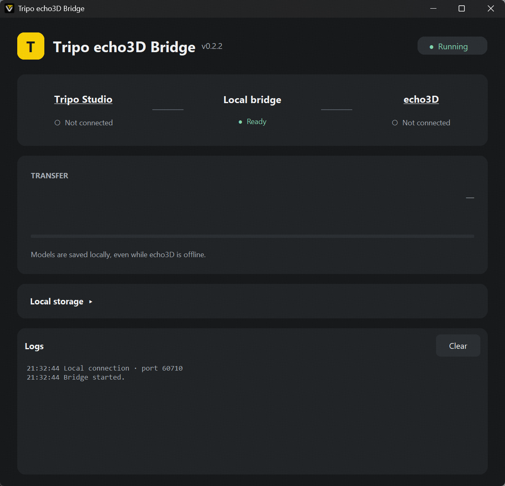

# Tripo Echo3D Bridge

Local desktop demo that hands a GLB from Tripo Studio to an echo3D receiver on the same machine. It does not sign in to Tripo, download assets, or upload anything to the echo3D cloud.



The Bridge listens on `127.0.0.1:60710` only. A remote server cannot open that socket. Whatever receives the model has to run on the user's computer, then call echo3D from there.

## Choose an integration

This repository is a demonstration you can build on. It is not a finished echo3D integration. Decide which side owns the handoff:

- **Frontend.** A page in the user's browser connects to `ws://127.0.0.1:60710/echo3d`, reassembles the GLB, and calls your existing upload or import API. `web/echo3d-demo.html` and `web/echo3d-bridge-client.js` are a reference for that path. The demo page only displays the file, its SHA-256, and a download button.
- **Backend.** A process on the same computer connects to the same WebSocket, reassembles the GLB, and forwards it to your echo3D services. There is no backend SDK in this repository. Implement the handshake and chunk protocol yourself, or start from the browser client and move that logic server-side.

Tripo Studio connects to `ws://127.0.0.1:60710/`. Both sides use `handshake`, `file_transfer`, and a per-chunk `file_transfer_ack`.

The Bridge saves each model locally before echo3D is connected, then replies to Tripo with `import_complete` / `file_loaded` and `completionStage: local_saved`. That result means the file is on disk. It does not mean echo3D accepted it. When an echo3D client connects, pending models are delivered in order. The queue survives a Bridge restart. A dropped connection can deliver the same model again. Deduplicate with the stable `deliveryId`, which is the `fileId` on the delivery frame.

## Run

```powershell
python -m pip install -r requirements.txt
python desktop_main.py
```

Or start `dist/Tripo-Echo3D-Bridge.exe`. The target machine does not need Python.

### Cache folder

Received models go to `%LOCALAPPDATA%/Tripo/Echo3DBridge/received/` on Windows, and to `~/Library/Application Support/Tripo/Echo3DBridge/received/` on macOS. Each model has its own directory, so identical file names do not overwrite each other. The chosen root is stored in `settings.json` in that same Tripo folder.

In the window, expand **Local storage**, then use **Change…** to pick a writable folder. The change applies immediately and is kept across restarts. **Open folder** opens the current directory. The folder cannot be changed while a model is being saved or delivered. Files already on disk stay where they are.

### Desktop window

**Tripo Studio** opens the local sender at http://127.0.0.1:60710/bridge-client.html. **echo3D** opens the local demo receiver at http://127.0.0.1:60710/demo. Neither link signs the user in or uploads to echo3D.

The transfer title is the model name. It stays empty when nothing is transferring. **Saved to your computer** means the local copy is complete. **Delivered to echo3D** appears only after the receiver confirms. Logs stay visible and scroll inside the log panel. **Clear** empties them.

If port 60710 is taken, the status turns red (`Port in use` / `Waiting for port`) and the Bridge retries every 3 seconds. No dialog blocks the window. When the port is free, the status returns to green `Running` without a restart. Connected still reflects the live clients. Closing the window stops the retry immediately. If Windows refuses the bind (error 10013), the window reports access denied instead of a port conflict; fix the cause and start the Bridge again.

An unfinished transfer is left as a `.part` file and is cleaned up on disconnect. It is not reported as success.

## Try the demo

1. Start the Bridge.
2. Click **Tripo Studio** to open `bridge-client.html`, connect, and send a GLB. The page defaults to port 60710. The desktop window should show the file name, then **Saved to your computer**. **Open folder** shows the saved file.
3. Click **echo3D** in the window, or open http://127.0.0.1:60710/demo, then click **Connect**.
4. The demo lists the model with its SHA-256 and a download button. Models sent later are delivered the same way.

## Reference browser client

`onTransfer` is where a frontend integration calls your own upload or import flow. Return `{ success, message }` only after that work finishes. The helper assembles chunks and sends acknowledgements. It does not contain echo3D credentials or an upload API.

```js
import { Echo3DBridgeClient } from './web/echo3d-bridge-client.js'
const bridge = new Echo3DBridgeClient({
  role: 'echo3d',
  async onTransfer(glb, metadata) {
    await uploadToEcho3D(glb, metadata.fileName)
    return { success: true, message: 'echo3D import complete' }
  }
})
await bridge.connect()
```

Closing the desktop window releases port 60710.

## Package

Windows, from this folder:

```powershell
./build.ps1
```

The executable is `dist/Tripo-Echo3D-Bridge.exe`.

macOS, on a Mac:

```bash
./build.sh
```

The app is `dist/Tripo-Echo3D-Bridge.app`, and a zip of that app is `dist/Tripo-Echo3D-Bridge-mac.zip`. A Windows machine cannot build this package. Run the script on macOS, or run the **Build macOS** workflow in GitHub Actions and download the artifact. The first launch may require right-click → Open, because the app is not notarized.

Development check: `python -m unittest discover -s tests -v`. The listener binds both IPv4 and IPv6 loopback. `web/bridge-client.html` is an optional protocol tool on port 60710, not the Bridge window.
